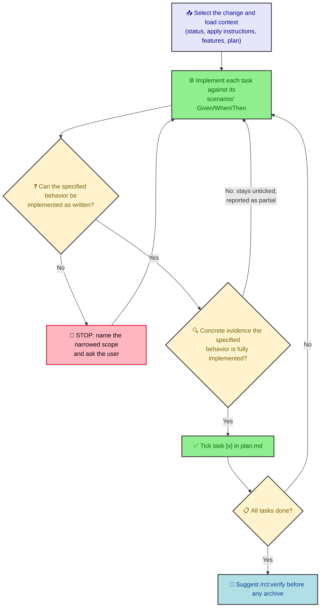

# `ratchet apply`

Implement a single existing change headlessly. `apply` runs exactly one agent for
a **forced** `apply` transition through the change-scoped engine core
(`runChangeStep`), with no batch manifest in sight. Run state is kept
change-locally under `.ratchet/changes/<change>/.run/`.

## Overview

The diagram below covers the **`/rct:apply` skill loop** — the agent-facing
apply workflow that selects a change, loads its context, and works through the
plan's tasks — which is the surface the apply scope-honesty rules govern. It
does not depict the headless `ratchet apply` CLI invocation documented in the
rest of this page; the CLI merely spawns one agent that runs this loop.



## Synopsis

```bash
ratchet apply <change> [options]
```

`<change>` is required: the name of an existing change under
`.ratchet/changes/<change>/`.

## Options

| Option | Argument | Description |
|---|---|---|
| `--force` | | Bypass the missing-plan precondition. The change-exists check still holds. |
| `-m, --message` | `<guidance>` | Extra guidance for the agent. Repeatable; joined into one "Additional guidance:" block. |
| `--agent` | `<agent>` | Override the coding agent for this step. |
| `--locus` | `<locus>` | Where the agent runs: `local`, `docker`, or `remote`. |
| `--image` | `<image>` | Container image for `--locus docker`. |
| `--allow-agent-override` | | Allow `RATCHET_BATCH_AGENT_CMD` to stand in for the coding agent. Without this flag, an active override is refused and nothing is spawned. See [Agent-command override](../engine/agent-runtime.md#agent-command-override). |
| `--json` | | Output the structured step result as JSON. A step that ran under an allowed override carries `"agentOverride": true`. |

## Preconditions

Read from on-disk change state before any settings resolution or spawn:

- **The change must exist.** A non-existent change
  (`.ratchet/changes/<change>/` absent) fails with an actionable error and **no
  spawn**. This check is never bypassed by `--force`.
- **The change must have a `plan.md`.** A change with no plan fails asking the
  user to run `ratchet propose` first, with **no spawn**. `--force` bypasses this
  check only.

## Behavior

1. Enforce the preconditions above.
2. Resolve settings standalone (`flag → project config → default`) via
   `resolveChangeStepSettings`. An invalid `--agent`/`--locus`/`--image` fails
   before any agent is spawned. A malformed `agent[:model]` spec (empty agent or
   model part, e.g. `claude:`, `:fable`; whitespace-padded like `claude: opus`,
   `claude :m`, `" claude"`; or a model part starting with `-` like
   `claude:-flag`) is rejected with an actionable error **naming the offending
   value** before any spawn — the same shared schema (`AgentSettingSchema` →
   `parseAgentSpec`) the load and write paths use, so the flag path can never
   diverge from what the loader accepts.
3. Build a `ChangeStepContext` with `batch` undefined, `transition: 'apply'`,
   the joined `-m` guidance, and the change-local journal, then run once via
   `engine.runChangeStep`. `computeNextTransition` is never consulted.
4. Render the structured `StepResult` as text, or as JSON with `--json`. The
   outcome journal entry is written under `.ratchet/changes/<change>/.run/`, so a
   `blocked` or `awaiting-approval` step stays resumable.


## Apply scope honesty

The apply workflow (the `/rct:apply` skill loop above) holds its completion
claims to what it proved:

- The `/rct:apply` skill and the `/rct:apply` command render from one shared
  body constant (`APPLY_BODY` in `src/core/templates/workflows/apply-change.ts`);
  neither carries its own copy of the apply instructions.
- Scope narrowing is a stop-name-ask event, never silent. When the specified
  behavior cannot be implemented as written, the agent stops, names the scope
  it would have to narrow, and asks the user before proceeding — an unwritten
  intention is an omission, and omissions are the user's decision, never the
  agent's.
- A task is ticked `[x]` in `plan.md` only with concrete evidence the
  specified behavior (the task text and each related Scenario's
  Given/When/Then) is fully implemented. Partial, inferred, or intended work
  stays unticked and is reported as partial in the session status.
- When all tasks are done, apply suggests running `/rct:verify` so the
  completion claims are checked before any archive; archive is not presented
  as the immediate next step.
- The `ratchet instructions apply --json` payload defers to these rules in
  minimal wording: the schema apply instruction and the ready-state fallback
  tick a task only once its specified behavior is fully implemented with
  evidence, and the `all_done` instruction suggests `/rct:verify`.

## Report channel

The spawned agent's prompt names no batch. It reports through
[`ratchet report <change>`](./report.md) (`--status`, `--blocker`,
`--needs-input`, `--complete`), which appends to the change-local journal the
engine reads for this step. A `--complete` report maps the step to `advanced`;
an agent that exits without one leaves the step `blocked`.

## Run state

Run state is written under `.ratchet/changes/<change>/.run/` — never under
`.ratchet/batches/`. See [Run-state locus](../engine/run-state.md).

## Help group

`apply` is listed under the `Workflow:` heading in `ratchet --help`, after
`propose` and before `verify`. See [Workflow help group](./workflow-help.md).
