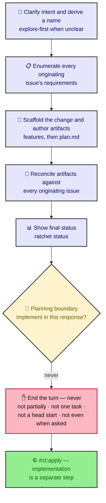

# `ratchet propose`

Create a single change headlessly from a free-text objective. `propose` runs
exactly one agent for a **forced** `propose` transition through the change-scoped
engine core (`runChangeStep`), with no batch manifest in sight. Run state is kept
change-locally under `.ratchet/changes/<change>/.run/`.

## Overview



The diagram above covers the **`/rct:propose` skill loop** — the agent-facing
propose workflow that clarifies intent, authors the change artifacts, and stops
at the planning boundary — which is the surface the planning-boundary rules
govern. It does not depict the headless `ratchet propose` CLI invocation
documented in the rest of this page; the CLI merely spawns one agent that runs
this loop.

## Synopsis

```bash
ratchet propose "<objective>" [options]
```

`<objective>` is required: the free-text description the change is created
toward.

## Options

| Option | Argument | Description |
|---|---|---|
| `--name` | `<change>` | Explicit change name; overrides the slug derived from the objective. |
| `-m, --message` | `<guidance>` | Extra guidance for the agent. Repeatable; each value is accumulated and the values are joined into one "Additional guidance:" block. |
| `--agent` | `<agent>` | Override the coding agent for this step. |
| `--locus` | `<locus>` | Where the agent runs: `local`, `docker`, or `remote`. |
| `--image` | `<image>` | Container image for `--locus docker`. |
| `--allow-agent-override` | | Allow `RATCHET_BATCH_AGENT_CMD` to stand in for the coding agent. Without this flag, an active override is refused and nothing is spawned. See [Agent-command override](../engine/agent-runtime.md#agent-command-override). |
| `--json` | | Output the structured step result as JSON. A step that ran under an allowed override carries `"agentOverride": true`. |

## Behavior

1. **Change-name derivation.** The change name is the explicit `--name` when
   given, otherwise a kebab-case slug derived from the objective. An objective
   that yields no sluggable characters and no `--name` fails with an actionable
   error and **no agent is spawned**.
2. **Refuse-if-exists.** If `.ratchet/changes/<change>/` already exists, the
   command fails before resolving settings or spawning — `propose` creates a new
   change, it does not resume an existing one. Use `apply`/`verify` to advance an
   existing change, or pass `--name <other>`. A directory whose only entry is
   `.run/` (reports posted with [`ratchet report`](./report.md) before the
   change was scaffolded) does not count as existing. After the agent exits, the
   engine stamps a missing `.ratchet.yaml` only into a scaffolded change; a
   `.run/`-only directory left by an early `--blocker` stays unstamped, so
   re-running `propose --name <change>` is not refused.
3. **Standalone settings.** Settings resolve `flag → project config → default`
   via `resolveChangeStepSettings` (no manifest). An invalid `--agent`,
   `--locus`, or `--image` value fails with an actionable error before any agent
   is spawned. A malformed `agent[:model]` spec (empty agent or model part,
   e.g. `claude:`, `:fable`; whitespace-padded like `claude: opus`, `claude :m`,
   `" claude"`; or a model part starting with `-` like `claude:-flag`) is
   rejected with an actionable error **naming the offending value** before any
   spawn — the same shared schema (`AgentSettingSchema` → `parseAgentSpec`)
   that the load and write paths use, so the flag path can never diverge from
   what the loader accepts.
4. **Forced propose.** A `ChangeStepContext` is built with `batch` undefined,
   `transition: 'propose'`, the joined `-m` guidance, and the change-local
   journal, then run once via `engine.runChangeStep`. `computeNextTransition` is
   never consulted — the verb name is the transition.
5. **Result.** The structured `StepResult` is rendered as text, or as JSON with
   `--json`. The engine has already written the outcome journal entry under
   `.ratchet/changes/<change>/.run/`, so a `blocked` or `awaiting-approval` step
   stays resumable.


## Planning boundary

The `/rct:propose` workflow authors the change artifacts — the executable
Gherkin features and `plan.md` — and its work ends there. It never implements
the plan's tasks in the same response that authored them: not partially, not
one task, not a head start, and not even when the user asks in the same
breath. After authoring, reconciliation, and the final status, the agent ends
its turn. Implementation is a separate [`/rct:apply`](./apply.md) step.

## Report channel

The spawned agent's prompt names no batch. It reports through
[`ratchet report <change>`](./report.md) (`--status`, `--blocker`,
`--needs-input`, `--complete`), which appends to the change-local journal the
engine reads for this step. A `--complete` report maps the step to `advanced`;
an agent that exits without one leaves the step `blocked`.

## Run state

Run state for the change is written under `.ratchet/changes/<change>/.run/`
(`journal.jsonl`, `state.json`) — never under `.ratchet/batches/`. See
[Run-state locus](../engine/run-state.md).

## Help group

`propose` is listed under the `Workflow:` heading in `ratchet --help`, before
`apply`, `verify`, `batch`, and `eval`. See [Workflow help group](./workflow-help.md).
