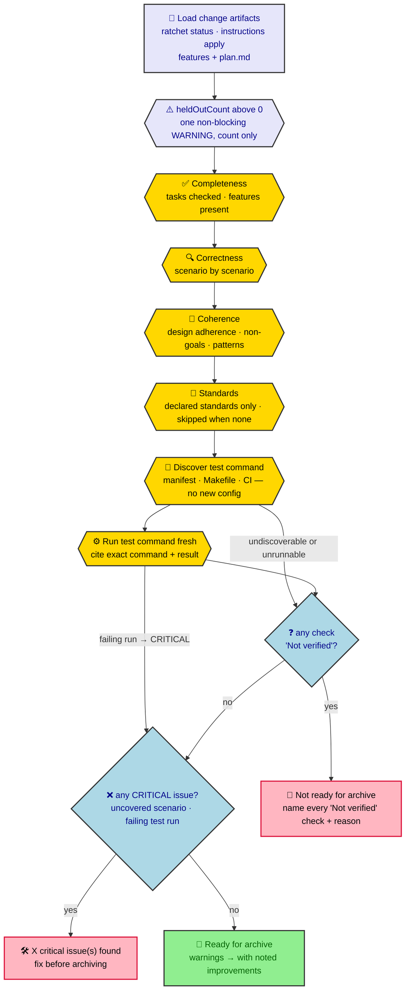

# `ratchet verify`

Verify a single existing change headlessly. `verify` runs exactly one agent for a
**forced** `verify` transition through the change-scoped engine core
(`runChangeStep`), with no batch manifest in sight. Run state is kept
change-locally under `.ratchet/changes/<change>/.run/`. It completes the headless
`propose → apply → verify` loop on a single change.

## Overview



The verify agent loads the change artifacts, checks four dimensions —
Completeness, Correctness, Coherence, and the Standards the change declared
(skipped when it declared none) — then discovers the project's own test command
and runs it fresh. The final assessment is gated: "Ready for archive" appears
only when every applicable check ran and no CRITICAL issues remain. Any check
reported "Not verified", or any CRITICAL issue, blocks readiness.

## Synopsis

```bash
ratchet verify <change> [options]
```

`<change>` is required: the name of an existing change under
`.ratchet/changes/<change>/`.

## Options

| Option | Argument | Description |
|---|---|---|
| `--force` | | Bypass the unfinished-tasks precondition. The change-exists check still holds. |
| `-m, --message` | `<guidance>` | Extra guidance for the agent. Repeatable; joined into one "Additional guidance:" block. |
| `--agent` | `<agent>` | Override the coding agent for this step. |
| `--locus` | `<locus>` | Where the agent runs: `local`, `docker`, or `remote`. |
| `--image` | `<image>` | Container image for `--locus docker`. |
| `--allow-agent-override` | | Allow `RATCHET_BATCH_AGENT_CMD` to stand in for the coding agent. Without this flag, an active override is refused and nothing is spawned. See [Agent-command override](../engine/agent-runtime.md#agent-command-override). |
| `--json` | | Output the structured step result as JSON. A step that ran under an allowed override carries `"agentOverride": true`. |

## Preconditions

Read from on-disk change state before any settings resolution or spawn:

- **The change must exist.** A non-existent change
  (`.ratchet/changes/<change>/` absent) fails with an actionable error and **no
  spawn**. This check is never bypassed by `--force`.
- **Every `## Tasks` checkbox must be checked** (`applied`). A change with
  unfinished tasks fails — naming the `<done>/<total>` task count — asking the
  user to finish `ratchet apply` first, with **no spawn**. `--force` bypasses
  this check only.

## Behavior

1. Enforce the preconditions above.
2. Resolve settings standalone (`flag → project config → default`) via
   `resolveChangeStepSettings`. An invalid `--agent`/`--locus`/`--image` fails
   before any agent is spawned. A malformed `agent[:model]` spec (empty agent or
   model part, e.g. `claude:`, `:fable`; whitespace-padded like `claude: opus`,
   `claude :m`, `" claude"`; or a model part starting with `-` like
   `claude:-flag`) is rejected with an actionable error **naming the offending
   value** before any spawn — the same shared schema (`AgentSettingSchema` →
   `parseAgentSpec`) the load and write paths use, so the flag path can never
   diverge from what the loader accepts.
3. Build a `ChangeStepContext` with `batch` undefined, `transition: 'verify'`,
   the joined `-m` guidance, and the change-local journal, then run once via
   `engine.runChangeStep`. `computeNextTransition` is never consulted.
4. Render the structured `StepResult` as text, or as JSON with `--json`. The
   outcome journal entry is written under `.ratchet/changes/<change>/.run/`, so a
   `blocked` or `awaiting-approval` step stays resumable.

## Verify report honesty

The verify agent's report follows these rules:

- A Scenario with no implementation and no test covering it is a **CRITICAL**
  issue ("Scenario not covered: \<name\>") and appears in the report's CRITICAL
  priority list. It is never a WARNING.
- Any applicable check that could not run — artifacts unreadable, search
  inconclusive, test command undiscoverable or unrunnable — is reported
  **"Not verified"** with the reason. A "Not verified" check is never scored as
  passing, and every "Not verified" check blocks "Ready for archive"; the final
  assessment names each such check and its reason instead of claiming readiness.
- Before generating the report, the agent discovers the project's own test
  command from the project itself (package manifest test script, Makefile test
  target, CI configuration — whatever the project already declares), runs it
  fresh, and cites the exact command and the fresh result. No ratchet
  configuration is added for this. An undiscoverable or unrunnable command is
  "Not verified"; a failing run is a CRITICAL issue.
- Reasonable inference does not count as test evidence — test evidence means a
  fresh run of the project's own test command.
- When plan.md carries a `## Non-goals` section, the report flags as a
  **WARNING** each listed Non-goal the implementation implements anyway —
  "Non-goal implemented: \<entry\>", naming the entry, with the recommendation
  to remove the out-of-scope implementation or confirm the reversed decision
  with the user and update plan.md's `## Non-goals`. A plan without the
  section, or with the explicit nothing-ruled-out one-liner, skips the check
  and is never failed for lacking it.
- "Ready for archive" appears only when every applicable check ran and no
  CRITICAL issues remain.
- `@holdout` handling is unchanged: one non-blocking WARNING naming only the
  held-out scenario count (see [Hold-out scenarios](#hold-out-scenarios)).


## Report channel

The spawned agent's prompt names no batch. It reports through
[`ratchet report <change>`](./report.md) (`--status`, `--blocker`,
`--needs-input`, `--complete`), which appends to the change-local journal the
engine reads for this step. A `--complete` report maps the step to `advanced`;
an agent that exits without one leaves the step `blocked`.

## Run state

Run state is written under `.ratchet/changes/<change>/.run/` — never under
`.ratchet/batches/`. See [Run-state locus](../engine/run-state.md).

## Hold-out scenarios

`ratchet verify` reads the same filtered `contextFiles` that `ratchet apply`
reads — `@holdout`-tagged Scenarios are stripped from the `.feature` files
before the verify agent reads them. This is intentional: `verify` shares the
`generateApplyInstructions` builder with `apply`; re-using it prevents the
verify loop from leaking held-out content back to the building agent.

If the change has held-out Scenarios, the JSON output of
`ratchet instructions apply --json` carries `heldOutCount > 0` and the verify
agent emits a non-blocking WARNING naming the count only:

> WARNING: N @holdout scenario(s) are excluded from this view — run `ratchet eval run` to enforce them.

The verify agent must NOT treat a held-out Scenario's absence as a coverage
gap — held-out Scenarios are legitimately absent from the filtered view;
enforcement is `eval run`, which reads the real source file directly.

See [`ratchet eval`](./eval.md) for the enforcement surface and
[`ratchet instructions`](./instructions.md) for filtering details.

## Help group

`verify` is listed under the `Workflow:` heading in `ratchet --help`, after
`apply` and before `batch`. See [Workflow help group](./workflow-help.md).
