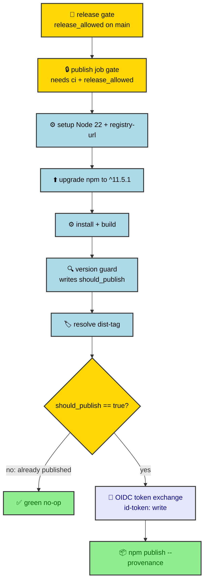

# Release publish

The `publish` job in `.github/workflows/ci.yml` uploads `ratchet-ai` to the npm
registry with a provenance attestation. It authenticates through npm trusted
publishing (GitHub OIDC). No npm token secret is used.

## Overview

## Gates

The job runs only when both conditions hold: `needs: [ci]` and
`if: needs.ci.outputs.release_allowed == 'true'`. The `ci` job sets
`release_allowed` from the release gate, which allows a release only on `main`
with every quality gate green. Any other value skips the job (fail-closed).

## Permissions

The job holds `id-token: write` and `contents: read`. `id-token: write` lets npm
obtain a GitHub OIDC token for the trusted-publishing exchange and for the
provenance attestation. `contents: read` is the minimum the checkout needs.

## Setup Node.js

`actions/setup-node` installs Node 22 with `registry-url:
https://registry.npmjs.org`, which writes the registry line into `.npmrc`. No
auth token is configured.

## Upgrade npm for trusted publishing

`npm install -g npm@^11.5.1`. Trusted publishing requires npm CLI 11.5.1 or later
and Node 22.14.0 or later. Node 22 ships npm 10.x, which has no OIDC support. The
caret range prevents a future npm major from changing publish behavior unreviewed.

## Install and build

`pnpm install --frozen-lockfile` and `pnpm build` produce `dist/`, which the
version guard and dist-tag steps run.

## Version guard

`node dist/core/ci/version-guard.js` compares the local version with the versions
on the registry and writes `should_publish=true|false` to `GITHUB_OUTPUT`. An
already-published version yields `false` and the job stays green. The publish
step runs only when the value is the literal `true`.

## Resolve npm dist-tag

`node dist/core/ci/dist-tag.js` prints the dist-tag for the version in
`package.json`: the leading prerelease identifier (for example `beta`), or
`latest` for a stable version. The step records it as the `tag` output.

## Publish to npm (provenance)

`npm publish --provenance --access public --tag <resolved dist-tag>`, gated on
`should_publish == 'true'`. npm exchanges the job's OIDC token with the registry
for a short-lived publish credential. The step sets no `NODE_AUTH_TOKEN`, and the
workflow references no `NPM_TOKEN` secret. There is no token fallback.

## Trusted publisher configuration

The registry accepts the OIDC exchange only if the `ratchet-ai` package has a
matching trusted publisher on npmjs.com (package Settings, Trusted Publisher).

| Field | Value |
|---|---|
| Publisher | GitHub Actions |
| Owner | `joctaTorres` |
| Repository | `ratchet` |
| Workflow filename | `ci.yml` |
| Environment | empty |
| Allowed actions: `npm publish` | on |
| Allowed actions: `npm dist-tag` | off |

A configuration with no successful publish expires 48 hours after it is created.
Create it no earlier than 48 hours before the change that first publishes with it
merges to `main`. If it is missing or expired, the publish step fails with an
authentication error and nothing is published; recreate the configuration and
re-run the job. The version guard keeps the re-run idempotent.

The workflow triggers on `push` to `main`, an event npm accepts for trusted
publishing.
